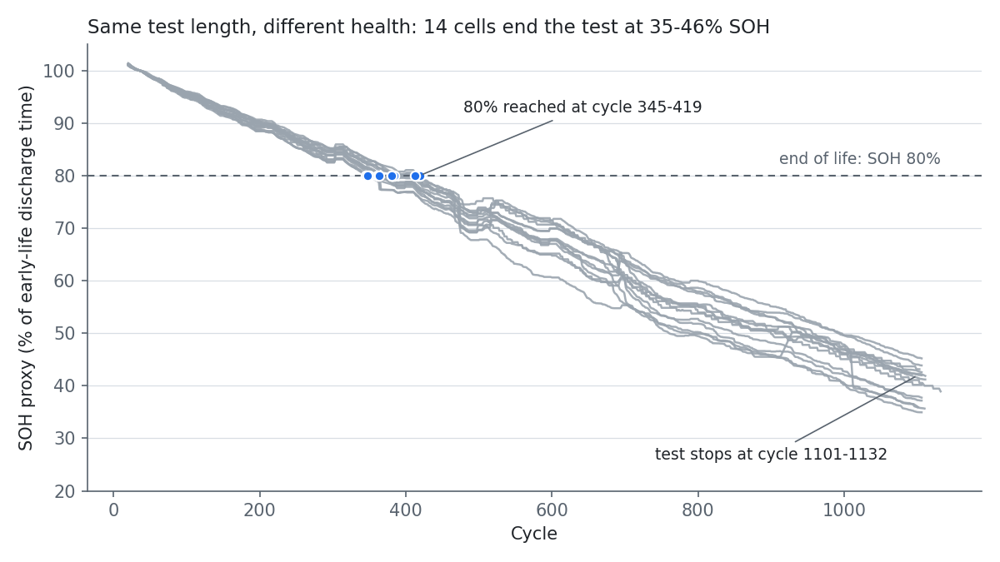

# Battery remaining-useful-life (RUL) regression — HNEI

Per-cycle regression of remaining useful life (RUL) on 14 NMC-LCO 18650 cells, validated on cells the model never saw in training.

**Main finding.** In the processed HNEI data, RUL is a countdown to the end of the test: RUL = (last cycle of the cell) − `Cycle_Index` exactly, and the last cycle is 1,103–1,134 for all 14 cells (SD 7.4). On held-out cells, the cycle counter alone predicts RUL with MAE 4.8 cycles; electrical features alone give 38.1. The benchmark measures position in the test schedule, not battery health. The electrical features do track degradation: each cell's mean prediction error correlates with its end-of-test discharge time, a capacity proxy (Spearman ρ = 0.87, 14 cells).

## State of health



SOH proxy: discharge time (constant current) over each cell's early-life median (cycles 10–60), smoothed with a centred 21-cycle rolling median. With end of life defined as SOH < 80%, the cells reach it at cycles 345–419 (mean 381, CV 6.9%), against a test-length CV of 0.7%. At the last cycle of the test, SOH is 35–46%. Tracking SOH against a fixed threshold is how a capacity guarantee is monitored; the label used by the RUL benchmark ignores it.

## Quick start

```
pip install -r requirements.txt
python download_data.py
python rul.py data/hnei_final_database.csv outputs
python -m pytest
```

`outputs/results.json` holds every figure. `WORKFLOW.md` explains each step.

## Data

Hawaii Natural Energy Institute (HNEI) cycling data: Devie, Baure & Dubarry, *Intrinsic variability in the degradation of a batch of commercial 18650 lithium-ion cells*, Energies 11(5), 1031 (2018). Processed copy from [ignavinuales/Battery_RUL_Prediction](https://github.com/ignavinuales/Battery_RUL_Prediction) (pinned commit, hash-checked; not redistributed here). 15,064 cycles; cell id reconstructed from 13 `Cycle_Index` resets; 597 rows (4.0%) dropped by two sanity rules; 14,467 used.

## Results

| | split | features | model | MAE (cycles) | RMSE |
|---|---|---|---|---|---|
| A | random 80/20 | electrical + `Cycle_Index` | LightGBM | 2.8 | 4.1 |
| B | random 80/20 | electrical | LightGBM | 17.4 | 26.6 |
| C | random 80/20 | `Cycle_Index` | LightGBM | 4.4 | 7.1 |
| **G** | **leave one cell out** | **`Cycle_Index`** | **Ridge** | **4.8** | **7.6** |
| H | leave one cell out | electrical + `Cycle_Index` | LightGBM | 5.8 | 8.6 |
| D | leave one cell out | electrical | LightGBM | 38.1 | 56.3 |
| E | leave one cell out | electrical | Ridge | 44.2 | 59.8 |
| F | leave one cell out | none | train mean | 277.2 | 320.6 |

- The counter generalizes across cells (C 4.4 → G 4.8). The random split only inflates models without it (B 17.4 → D 38.1).
- Adding electrical features to the counter makes it worse (G 4.8 → H 5.8).
- LightGBM beats Ridge on electrical features by 6.1 cycles MAE (cell-level bootstrap 95% CI 0.7–10.8; lower error in 11 of 14 cells).
- Protocol D error grows through life: MAE 14.8 cycles in the first 20% of life, 63.8 in the last 20%.

## Layout

```
rul.py                      pipeline: load, clean, eight protocols, error breakdowns, SOH
download_data.py            pinned, hash-checked data download
tests/test_pipeline.py      data, target and split checks
.github/workflows/ci.yml    lint, tests, pipeline run and results check on every push
outputs/results.json        figures from the last run
outputs/soh.png             SOH proxy per cell, from the last run
```

## Limits

14 cells, one chemistry, one temperature, one current. The RUL label ends where the test ended, not at a health threshold, so there is almost no between-cell variance in lifetime to predict. Features come from the dataset authors, not re-derived from raw traces. 86% of the rows removed by the voltage rule are in the last 40% of life, so late-life error is measured on the cycles that pass that filter.

The SOH proxy is delivered capacity at the test discharge rate, so it includes resistance growth, not only capacity loss. Next step: predict the SOH-defined end of life (cycles 345–419) from early-life cycles, which gives the cells genuinely different lifetimes to predict.
