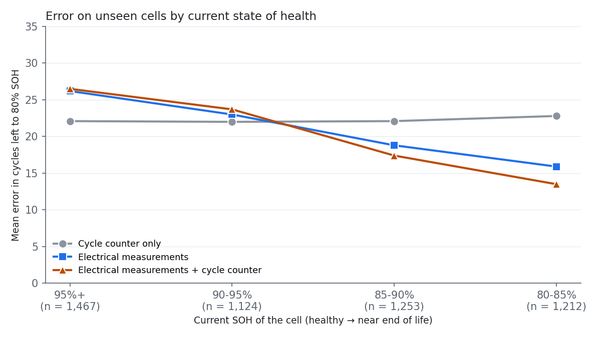
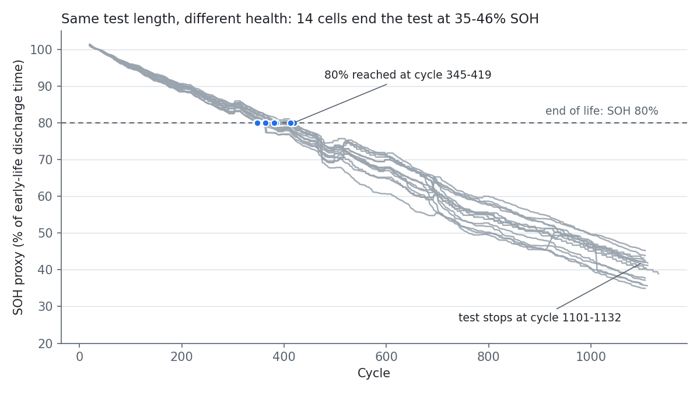

# Predicting when a lithium-ion battery wears out

Rechargeable batteries lose a little capacity every time they are charged and discharged. A common rule calls a battery worn out, at its "end of life", once it holds only 80% of its original capacity. Knowing how many cycles a battery has left before that point helps plan replacements and check warranties, from phones to grid storage.

This project uses public lab data from 14 identical lithium-ion cells and asks a simple question: from the electrical measurements of a single charge and discharge, can a model tell how many cycles a cell has left before it reaches 80%, for a cell it has never seen before?

## Main result: the measurements help as a battery nears the end of its life



The chart compares three ways of estimating the cycles left, each tested on cells the model never saw during training. Lower is better.

- **While a cell is still healthy (above 90% of its capacity),** counting cycles is as good as anything: every approach misses by about 22 to 27 cycles, and the measurements do slightly worse than the count alone.
- **As a cell approaches 80%,** the measurements start to pay off. Over the last 100 cycles before end of life, combining them with the cycle count cuts the average miss from 23 cycles to 13.
- **How sure we are.** The result holds up under several checks: shuffling which cell ends when makes the advantage disappear, a different smoothing method gives the same picture, and the charging measurements alone show it too. It rests on only 14 cells, though. With a stricter end-of-life rule (85%) the advantage shrinks into the noise, and with a looser one (75%) it becomes clearer. Treat it as a promising first result that needs more batteries to confirm.

## A second finding: a popular benchmark measures the length of the experiment

This dataset is often used to test such predictions with a ready-made "cycles left" label. That label counts down to the day the experiment stopped, which came at almost the same cycle for every cell. The cycle number alone therefore predicts it almost perfectly: on unseen cells the average miss is 4.8 cycles out of about 1,110, while a model reading the electrical measurements misses by 38.

Measured by health instead, the story changes. The cells reached 80% of their original capacity at very different points, between cycle 345 and cycle 419, and kept running until the experiment ended, with only 35% to 46% of their capacity left. The main result above uses this health-based end of life.



## Run it

```
pip install -r requirements.txt
python download_data.py
python rul.py data/hnei_final_database.csv outputs
python -m pytest
```

Every number in this README and in `TECHNICAL.md` comes from `outputs/results.json`, which the last command regenerates. An automatic check on GitHub reruns everything on each change and fails if any number moves.

## Files

```
rul.py                      the whole analysis: data, models, checks, figures
download_data.py            fetches the data and verifies it is the exact same file every time
tests/test_pipeline.py      automated checks on the data and the validation
.github/workflows/ci.yml    reruns lint, tests and the analysis on every push
outputs/results.json        every number from the last run
outputs/soh_target.png      the main result chart
outputs/soh.png             capacity curves of the 14 cells
TECHNICAL.md                methods, all model variants, statistics and limits
```

## Data

Hawaii Natural Energy Institute (HNEI) cycling data of 14 NMC-LCO 18650 cells: Devie, Baure & Dubarry, *Intrinsic variability in the degradation of a batch of commercial 18650 lithium-ion cells*, Energies 11(5), 1031 (2018). Processed copy from [ignavinuales/Battery_RUL_Prediction](https://github.com/ignavinuales/Battery_RUL_Prediction), downloaded by `download_data.py`.
